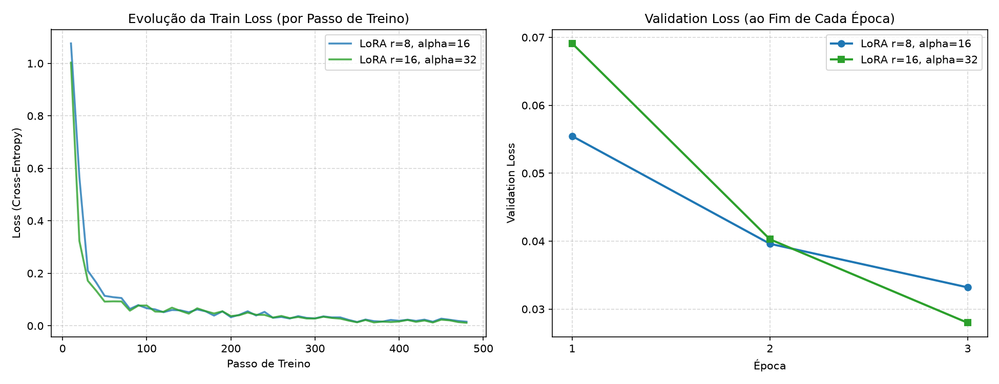
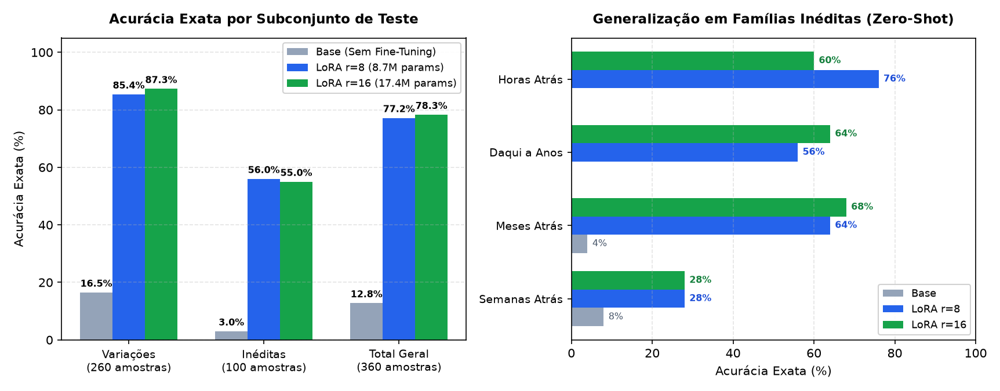
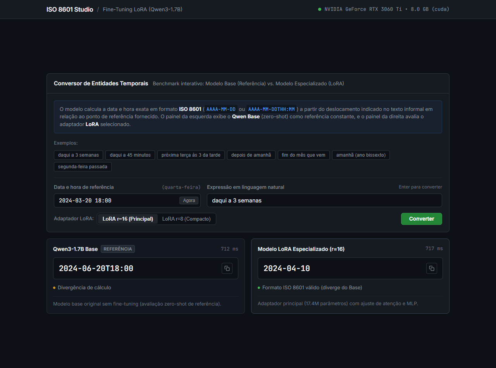

# CP5 - Fine-Tuning de LLM (LoRA) para Normalização Temporal (ISO 8601)

Repositório acadêmico desenvolvido para a disciplina de **Inteligência Artificial Generativa (CP5)** - FIAP (2026).

## Integrantes do Grupo

| Nome do Aluno | RM |
| :--- | :--- |
| **Lucas Moreno Matheus** | 97158 |
| **Lorenzo Gomes Andreata** | 551117 |

## 1. Problema Abordado e Escolha da LLM

* **Problema:** Conversão de expressões informais de data e hora em português brasileiro (ex.: *"próxima terça às 3 da tarde"*, *"daqui a 3 semanas"*, *"depois de amanhã"*, *"fim do mês que vem"*) em carimbos temporais estritos no padrão **ISO 8601** (`AAAA-MM-DD` ou `AAAA-MM-DDTHH:MM`), a partir de uma data de referência fornecida.
* **LLM Selecionada:** [`Qwen/Qwen3-1.7B`](https://huggingface.co/Qwen/Qwen3-1.7B) (família Qwen3, autorizada no enunciado).
* **Motivação:** Modelos fundacionais compactos possuem capacidade de raciocínio linguístico, mas falham sistematicamente em tarefas determinísticas de formatação: geram respostas prolixas com textos excedentes (incompatíveis com contratos de APIs) e cometem erros aritméticos frequentes em cálculos de calendário relativo. O fine-tuning direciona o modelo a operar como um conversor canônico determinístico.

## 2. Metodologia de Fine-Tuning e Parâmetros Testados

O treinamento foi conduzido localmente em **GPU dedicada (NVIDIA GeForce RTX 3060 Ti de 8 GB VRAM)** utilizando PyTorch com aceleração CUDA em precisão nativa **bfloat16**.

### Arquitetura de Adaptação (PEFT / LoRA)

* **Técnica:** LoRA (*Low-Rank Adaptation*) aplicada a todas as projeções lineares de atenção e MLP do modelo (`q_proj`, `k_proj`, `v_proj`, `o_proj`, `gate_proj`, `up_proj`, `down_proj`).
* **Loss Masking:** Rótulo `-100` aplicado a todas as instruções do prompt e tokens de preenchimento (*padding*). A perda por entropia cruzada incide exclusivamente sobre os tokens da resposta ISO 8601 e o terminador `<|im_end|>`.
* **Chat Template:** Formatação ChatML sem tokens de pensamento (*thinking* desabilitado), priorizando resposta imediata.

### Parâmetros Comparados

Conforme exigido pelo enunciado, foram comparadas duas configurações de parâmetros estruturais do LoRA:

| Configuração | Rank ($r$) | Alpha ($\alpha$) | Parâmetros Treináveis | % do Modelo Total |
| :--- | :---: | :---: | :---: | :---: |
| **Experimento 1 (Compacto)** | 8 | 16 | 8.729.088 | 0,50% |
| **Experimento 2 (Principal)** | 16 | 32 | 17.458.176 | 1,00% |

* **Hiperparâmetros de Treino:** 3 épocas completas, lote efetivo de 16 (lote por dispositivo = 4 com 4 passos de acúmulo de gradiente), taxa de aprendizado de `2e-4` com decaimento cosseno e otimizador AdamW.

## 3. Conjunto de Dados

O dataset foi gerado proceduralmente ([`gerar_dados.py`](./gerar_dados.py)) com a biblioteca padrão `datetime` do Python, garantindo gabarito exato e reprodutível:

* **Treino:** 2.600 amostras balanceadas cobrindo 16 famílias sintáticas.
* **Validação:** 260 amostras.
* **Teste Independente (360 tarefas):**
  * **Variações Conhecidas (260 amostras):** Famílias sintáticas vistas no treino com datas/horas inéditas.
  * **Famílias Inéditas (100 amostras):** Quatro categorias propositalmente ocultadas do treino (`horas_atras`, `daqui_anos`, `meses_atras`, `semanas_atras`) para testar capacidade de generalização *zero-shot*.

## 4. Resultados e Avaliação Comparativa

### Dinâmica da Perda (Train Loss vs. Validation Loss)



* **LoRA r = 8:** Validation Loss final = `0.0382` (489 passos de otimização).
* **LoRA r = 16:** Validation Loss final = `0.0309` (489 passos de otimização).
* A configuração com rank $r=16$ obteve uma redução de **19,0% na Validation Loss** em comparação a $r=8$, convergindo com estabilidade e sem sobreajuste (*overfitting*).

### Placar de Acurácia no Teste (360 Tarefas)



A avaliação quantitativa mediu a **Acurácia Exata** (saída rigorosamente idêntica ao padrão ISO 8601 sem texto excedente) e a **Acurácia de Conteúdo** (presença da data correta no texto):

| Subconjunto de Teste | Qwen3-1.7B Base | LoRA r=8 (8.7M) | LoRA r=16 (17.4M) | Ganho Absoluto |
| :--- | :---: | :---: | :---: | :---: |
| **Variações Conhecidas** (260 tarefas) | 14,6% | 86,2% | **88,1%** | **+73,5 p.p.** |
| **Famílias Inéditas (Generalização)** (100 tarefas) | 2,0% | 51,0% | **55,0%** | **+53,0 p.p.** |
| **TOTAL GERAL** (360 tarefas) | **11,1%** | **76,4%** | **78,9%** | **+67,8 p.p.** |

* **Diagnóstico:** O modelo base sem fine-tuning alcançou apenas 11,1% de acerto estrito, prejudicado pela prolixidade e alucinações de calendário relativo. O fine-tuning com $r=16$ alcançou **78,9% de acurácia global (+67,8 p.p.)**, demonstrando forte capacidade de generalização mesmo em estruturas sintáticas nunca vistas no treino (55,0%).

## 5. Interface Gráfica para o Usuário

Atendendo ao requisito de fornecer uma interface para inserção do prompt pelo usuário, foi desenvolvido um aplicativo local (FastAPI + HTML/CSS/JavaScript):

* **Entrada Interativa:** Permite digitar livremente ou selecionar expressões temporais predefinidas, com data de referência ajustável.
* **Comparação Direta:** Exibe lado a lado a resposta da referência (**Qwen3-1.7B Base**) contra o modelo especializado (**LoRA r=16** ou **r=8**), indicando latência em milissegundos e validação do formato ISO.
* **Telemetria de GPU:** Detecta e exibe no cabeçalho o dispositivo ativo e a alocação de VRAM.



## 6. Estrutura do Repositório

```text
.
├── adapters/                       # Pesos dos adaptadores LoRA treinados
│   ├── lora_r8/                    # Adaptador compacto (rank 8, alpha 16)
│   └── lora_r16/                   # Adaptador principal (rank 16, alpha 32)
├── assets/                         # Gráficos de aprendizado, acurácia e print da interface
├── data/                           # Datasets em formato JSONL (treino, validação, teste)
├── frontend/                       # Interface gráfica do usuário (HTML5, CSS3, JS ES6+)
├── results/                        # Placares em CSV, predições em JSON e histórico de treino
├── .python-version                 # Versão fixada do Python (3.12)
├── 01_treino.ipynb                 # Geração de dados e fine-tuning LoRA (r=8 e r=16) na GPU
├── 02_avaliacao.ipynb              # Benchmark comparativo Base vs. LoRA, gráficos e placar
├── app.py                          # Servidor backend FastAPI (API de inferência e static files)
├── common.py                       # Constantes, template de prompt e funções compartilhadas
├── gerar_dados.py                  # Gerador procedural de dados sintéticos via CLI
└── pyproject.toml                  # Dependências e gerenciamento de ambiente via uv
```

## 7. Como Executar o Projeto

### Pré-requisitos

* Sistema operacional Windows ou Linux com GPU e suporte a CUDA (ou macOS com Apple Silicon).
* Gerenciador de dependências [`uv`](https://docs.astral.sh/uv/) instalado.

```bash
# 1. Instalar as dependências do ambiente
uv sync

# 2. Executar os cadernos Jupyter (com flags fast-skip ativadas para reprodução imediata)
uv run jupyter lab

# 3. Iniciar a aplicação web
uv run python app.py
```

A interface web estará acessível em `http://127.0.0.1:7860`.
